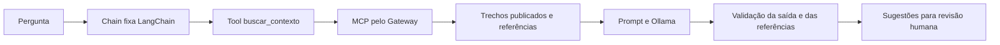

# Cliente de IA do ATHENA

Python 3.12, LangChain e Ollama local. O cliente analisa impactos e responde perguntas
usando requisitos reais. As sugestões ficam `PENDENTE_HUMANO`: o fluxo de IA não
aprova revisões, publica versões ou altera relações. O utilitário separado
`popular_demo.py` carrega fixtures fictícias quando executado explicitamente.

## Executar com Docker

Na raiz do repositório:

```sh
docker compose up -d --build --wait
docker compose exec agente-ia python -m athena_ia verificar
docker compose exec agente-ia python -m athena_ia perguntar "Qual é a meta de latência das consultas?"
docker compose exec agente-ia python -m athena_ia impacto --saida /resultados/impacto.json
```

O Compose inicia Ollama, baixa `qwen2.5:3b-instruct-q4_K_M` em volume persistente,
confere o SHA-256 do manifesto e aquece o modelo antes de liberar o cliente.
A primeira inicialização baixa aproximadamente 1,9 GB de pesos, além das imagens.
`modelo-ia` é uma tarefa de inicialização: seu término com código 0 é esperado.
`agente-ia` permanece disponível para comandos via `exec`; sua saúde verifica apenas
o processo local, para continuar disponível quando o LLM falhar.

Os arquivos em `/resultados` aparecem em `clientes/agente-ia/resultados` no host.
Essa pasta é ignorada pelo Git; copie apenas evidências revisadas para `docs/ia`.
Não há porta de IA exposta no host. O cliente alcança o Gateway por `edge` e o
Ollama pela rede interna `ia`, sem acesso às redes dos bancos.

## Retomar depois de reiniciar o computador

Na raiz do repositório, com o Docker em execução:

```sh
docker compose up -d --wait
docker compose exec -T agente-ia python -m athena_ia verificar
docker compose exec -T agente-ia python -m athena_ia aquecer
```

Não é necessário reconstruir as imagens quando o código não mudou. O comando
`verificar` exercita uma busca real no MCP; o healthcheck do serviço não carrega
o modelo de embeddings. Se o Gateway retornar HTTP 500 em `/mcp` e o MCP
reiniciar, confira os logs e eventos do Docker. Um evento `oom` seguido de saída
137 indica encerramento por falta de memória. O limite padrão do `impacto-mcp`
é 2 GiB, configurável por `IMPACTO_MCP_MEM_LIMIT` no `.env`, para acomodar a carga
inicial do modelo ONNX. Após mudar esse limite, aplique e valide:

```sh
docker compose up -d --no-deps --wait impacto-mcp
docker compose exec -T agente-ia python -m athena_ia verificar
```

## Fluxo manual de revisão e publicação no projeto local

O frontend ainda não oferece os botões desse fluxo. O utilitário separado
`fluxo_requisito.py` executa uma etapa solicitada por vez, pela API do Gateway.
Ele não usa o LLM, não é uma ferramenta da chain e não substitui o fluxo extra
de confirmação humana exigido para ações propostas pelo MCP.

Na raiz do repositório, consulte primeiro o conteúdo e os critérios da candidata:

```sh
ATHENA_REQ=5d59d1b9-5346-4c0d-9a18-8a01c998afb4
docker compose exec -T agente-ia python fluxo_requisito.py estado --requisito "$ATHENA_REQ"
```

Execute as etapas separadamente. A aprovação é a decisão de quem executa o
comando; informe uma justificativa que corresponda à sua revisão:

```sh
docker compose exec -T agente-ia python fluxo_requisito.py submeter --requisito "$ATHENA_REQ"
docker compose exec -T agente-ia python fluxo_requisito.py aprovar --requisito "$ATHENA_REQ" --justificativa "Revisei a descrição e os critérios de aceite e concordo com esta versão."
docker compose exec -T agente-ia python fluxo_requisito.py publicar --requisito "$ATHENA_REQ"
```

O fluxo é `RASCUNHO → EM_SUBMISSAO → AGUARDANDO_REVISAO → APROVADA → PUBLICADA`.
O script aguarda até 20 segundos pela transição. Se `transicao_confirmada` for
`false`, consulte `estado` antes de prosseguir: a mensagem pode ainda estar em
processamento. Publicar torna a versão elegível para o Livro e a indexação RAG,
que ocorre de forma assíncrona.

O utilitário é restrito ao projeto de demonstração e às URLs locais. Usa
`editor@athena.dev` em `estado`/`submeter` e `aprovador@athena.dev` em
`aprovar`/`publicar`, com a senha de demonstração `Athena@2026`. Para outras
credenciais locais, configure `FLUXO_EMAIL` e `FLUXO_SENHA` na execução. Cada
comando faz seu próprio login, sem reutilizar o token da interface ou salvar
credenciais em arquivos. Os POSTs usam ETag e chave de idempotência; não há
repetição automática de escritas após falha de comunicação. Pendências
bloqueantes e lotes de outra versão impedem a aprovação.

## Configuração

Copie `.env.example` da raiz para `.env` se precisar alterar os padrões. A chave
`LLM_CHAVE` é opcional e só é enviada ao endpoint configurado de Ollama/proxy.
Esta implementação usa a API Ollama; trocar para um provedor com outro protocolo
exige um adaptador de modelo, não apenas trocar a URL.

| Variável | Padrão / finalidade |
|---|---|
| `ATHENA_URL` | `http://gateway:8080` no Compose; `http://localhost:8080` fora dele |
| `ATHENA_EMAIL`, `ATHENA_SENHA` | Leitor de demonstração; nunca encaminhados ao LLM |
| `ATHENA_PROJETO_ID` | Projeto de demonstração `22222222-2222-4222-8222-222222222222` |
| `LLM_URL` | `http://ollama:11434` no Compose |
| `LLM_MODELO`, `LLM_MODELO_DIGEST` | Tag e SHA-256 aprovados; mudar ambos ao trocar pesos |
| `LLM_TIMEOUT` | 45 segundos por tentativa, limite total incluindo streaming |
| `LLM_TENTATIVAS`, `LLM_BACKOFF` | 2 tentativas totais, espera inicial 2 s; cresce 2, 4, 8… |
| `LLM_MAX_TOKENS`, `LLM_CONTEXTO` | 512 tokens de saída e contexto de 4096 tokens |
| `RAG_LIMITE` | 5 trechos, entre 1 e 20 |
| `PRECO_ENTRADA_USD_MILHAO`, `PRECO_SAIDA_USD_MILHAO` | 0,40 / 1,60, preços históricos de referência |

Em máquina sem GPU, medir os tempos antes da apresentação. O limite de 20 s vem
do livro; se o hardware exigir outro valor, registrar a mudança e os resultados
no relatório. Um timeout curto intencional pertence à demonstração de falha,
não à avaliação normal de qualidade.

## Fluxo implementado



`chain.py` compõe `RunnableLambda` em sequência e chama uma tool LangChain real
com `ainvoke`. O fluxo não depende de decisões de um agente autônomo. O backend
continua responsável por ingestão, embeddings multilingual-e5-small e pgvector.

O cliente faz login, conserva JWT, cookie de refresh e CSRF apenas em memória,
renova antes da expiração e repete uma consulta uma vez após HTTP 401. Um refresh
inválido permite novo login. Erros de permissão MCP, inclusive `-32003` em HTTP 200,
interrompem a operação; não são tratados como falta de evidência.

O prompt delimita os documentos como dados não confiáveis. A saída usa JSON com
esquema validado, e cada fonte citada deve existir no contexto. Essa checagem
verifica identidade das referências, não garante correção semântica: a revisão
humana continua necessária.

A gramática JSON também restringe os códigos aos alvos recuperados e as fontes
de cada sugestão ao respectivo requisito. Em erro de validação, a nova tentativa
recebe uma instrução de correção; a saída rejeitada fica no JSON da operação para
auditoria da qualidade, mas não é apresentada como sugestão aceita.

## Análise de impacto

O exemplo padrão compara a publicada v1 do REQ-1 com sua candidata v2, que
acrescenta PDF e Markdown. O cliente consulta metadados, as duas versões e o mapa,
busca o conteúdo dos vizinhos e acrescenta contexto publicado pelo MCP.

O detalhe `/requisitos/{id}` não contém o texto completo: usamos
`/requisitos/{id}/versoes/{versaoId}`. Uma fonte pode ser `API_PUBLICADA`,
`API_CANDIDATA`, `API_RELACIONADO` ou `MCP_PUBLICADO`. Os identificadores de versão
ficam no resultado. REQ-2 pode aparecer pela API/mapa mesmo sem estar publicado;
isso não significa que entrou no índice RAG.

As relações preservam origem, destino e tipo. A saída lista alvos, justificativas,
evidências e `PENDENTE_HUMANO`. O requisito analisado não pode ser sugerido como
outro alvo. O exemplo examina até dez vizinhos diretos mais os trechos MCP;
não promete análise transitiva exaustiva. Defasagem e truncamento do mapa são
registrados. Contextos excessivos falham explicitamente para evitar cortes silenciosos.

O diff de `titulo`, `conteudo` e `criteriosAceite` é calculado em Python, com antes
e depois. Para cada alvo recuperado, uma triagem fixa classifica o vínculo com a
parte alterada como `DIRETO`, `INDEPENDENTE` ou `INCERTO`. Só um vínculo direto
válido segue para a chamada de análise de riscos, que retorna `mudanca`,
`efeito`, `verificacao` e uma classificação: `REVISAR`, `SEM_IMPACTO_IDENTIFICADO`
ou `INDETERMINADO`. `fontes_ids` deve citar o alvo; `fontes_mudanca_ids`, as duas
versões do requisito alterado. Apenas `REVISAR` com geração válida entra em
`sugestoes`; todas as classificações ficam em `analises` e exigem revisão humana.
As fontes permitem auditar a identidade das citações, mas não garantem o sentido
do argumento. A triagem fica na saída e também exige revisão humana; ela pode errar.
Relações e similaridade não são usadas como prova de impacto. A sequência e o desvio
são definidos pelo programa; o modelo não escolhe ferramentas nem executa ações.
O campo `trecho_alvo` contém uma frase real escolhida entre trechos extraídos da
fonte; a gramática restringe essa escolha e o cliente verifica sua presença no
texto citado. O modelo continua responsável pelo argumento e pela classificação.
Cabeçalhos e títulos dos trechos MCP não são aceitos como prova de uma obrigação.
A triagem compara conteúdo e critérios, inclusive contradições; a entrada evita
duplicar os parágrafos do antes/depois. Esses cuidados não eliminam inferências
incorretas do modelo. O teste do REQ-12 preserva os acertos e os erros em
[`docs/ia/evidencias/req12-20261125`](../../docs/ia/evidencias/req12-20261125/README.md).
Revisar pode significar conferir testes de uma nova variante do fluxo, mesmo
quando o texto do requisito relacionado permanece válido.

Sem mudança nos três campos, o cliente devolve comparação determinística e não
chama o LLM. Alteração apenas no título produz uma conferência editorial pendente,
com antes/depois, sem sugerir impacto funcional automático nem chamar o LLM.
Isso não certifica equivalência: a pessoa deve conferir contradições e referências
ao título anterior. Para uma mudança funcional, alinhe conteúdo/critérios e analise
a candidata novamente. Uma falha em um
alvo fica `INDETERMINADO`, preserva análises válidas dos demais e marca a operação
`parcial` (ou `degradado` se todas falharem). Tempos e tokens somam todas as chamadas;
o timeout de 20 s é por tentativa de cada etapa/alvo, não um limite global da análise.

## Ampliar a demonstração e executar os controles

A base original tem dois requisitos publicados. O conjunto `dados/demo-v2.json`
acrescenta oito requisitos fictícios com conteúdo e critérios verificáveis:
rastreabilidade, acesso, auditoria, prévia, notificações, senha, tema e filtros.
São documentos de teste, não comprovação de que essas funcionalidades existem
na aplicação. Os marcadores `[IA-V2-...]` distinguem as fixtures dos originais.

```sh
# Ver o conteúdo que será criado; este comando não altera o ATHENA.
docker compose exec -T agente-ia python popular_demo.py
# Carregar no projeto local de demonstração (rodar uma instância por vez).
docker compose exec -T agente-ia python popular_demo.py --aplicar --saida /resultados/demo-v2
docker compose exec -T agente-ia python -m athena_ia aquecer
docker compose exec -T agente-ia python -m athena_ia avaliar --perguntas /resultados/demo-v2/perguntas.json --destino /resultados/v2
docker compose exec -T agente-ia python -m athena_ia avaliar-impactos --cenarios /resultados/demo-v2/impactos.json --destino /resultados/v2
```

A carga usa as APIs normais com ETags e chaves de idempotência para submissão,
decisão e publicação; aguarda saga, ativação do lote e aprovação. Depois verifica
cada versão publicada no MCP. Não escreve em bancos nem altera migrações, volumes
ou os três requisitos originais. Uma repetição reconhece marcadores e relações
simétricas e retoma o progresso; conteúdo divergente provoca interrupção, não
sobrescrita. Não repetir POSTs ambíguos de criação manualmente: retome o utilitário.

O utilitário é restrito a `localhost`, `127.0.0.1` ou `gateway` e ao projeto demo
`22222222-2222-4222-8222-222222222222`. Usa a conta demonstrativa de aprovador;
`DEMO_EMAIL`/`DEMO_SENHA` permitem substituir as credenciais. O agente continua
usando leitor. Essa carga determinística é separada do extra de aprovação pela
IA com confirmação humana, que continua fora do escopo implementado.

O manifesto registra os IDs/códigos efetivos; os arquivos de perguntas e cenários
são materializados a partir dele. Não suponha que uma fixture sempre receberá o
mesmo número em outro banco. A carga não restaura versões originais alteradas por
outra pessoa: os cenários I1–I3 pressupõem o estado descrito no dataset.

São doze perguntas × dois modos e três cenários de impacto:

- I1: PDF/Markdown no REQ-1, com alvos positivos, plausíveis e controles negativos.
- I2: só o título da prévia muda; não inferir mudança de comportamento.
- I3: candidata e publicada do filtro têm os mesmos campos; zero sugestões e zero chamadas ao LLM.

O cenário I1 inclui uma relação organizacional com recuperação de senha e uma
prévia explicitamente independente de formato. Tema e filtro ajudam a diversificar
a busca. Um alvo não recuperado não conta como uma rejeição correta: o relatório
separa `negativos_analisados` de `negativos_nao_avaliados`. O corpus ampliado ainda
é pequeno e controlado; não representa avaliação em produção.

## Comparação com e sem RAG

```sh
docker compose exec agente-ia python -m athena_ia aquecer
docker compose exec agente-ia python -m athena_ia avaliar --destino /resultados
```

`perguntas.json` contém cinco perguntas e critérios esperados. As cinco perguntas
rodam nos dois modos, alternando a ordem. O modo sem RAG não consulta MCP nem
injeta requisitos no prompt. As respostas esperadas nunca são enviadas ao modelo.
Modelo, seed, temperatura e limites são os mesmos. Não há cache de respostas;
Ollama pode reutilizar prefixos internamente, limitação registrada na avaliação.

Cada execução produz JSONs completos, `comparacao.csv` e `comparacao.md`. Registrar
correção (0–2), apoio nas fontes (0–2), reconhecimento de ausência de informação
(0–2), além de citações inventadas e omissões. `avaliacao_humana=PENDENTE` exige
revisão do grupo; o programa não inventa uma nota. Execuções degradadas devem ser
avaliadas como falhas operacionais, não como qualidade normal de geração.

Também são gerados `revisao-humana.csv` vazio e `RUBRICA.md`, com critérios de
notas 0, 1 e 2. Preencha notas, observações, seu nome e data apenas após ler as
evidências. Valide a ficha com `python -m athena_ia consolidar-revisao --arquivo
<pasta>/revisao-humana.csv` (via `docker compose exec -T agente-ia` para caminhos
em `/resultados`). O comando retorna médias por modo e contagem de pendências;
não modifica os JSONs brutos. Verifica formato e vínculo com a operação, não a
identidade real de quem escreveu. Uma análise assistida não vale como revisão humana.

As verificações automáticas indicam se as referências existem e se fontes
esperadas foram recuperadas. Não dão notas semânticas. Gabaritos e conjuntos de
positivos/negativos são usados somente depois da geração e nunca entram no prompt.

## Resiliência e falha ao vivo

Os dois mecanismos são (1) timeout/retry com backoff exponencial limitado e
(2) fallback determinístico contendo evidências, sem conclusão gerada. Um timeout
abrange a chamada completa, inclusive streaming. Erros HTTP permanentes como
401/404 do LLM não são repetidos; erros transitórios e saída inválida têm retries
limitados. Não há retries aninhados adicionais configurados.

```sh
docker compose stop ollama
docker compose exec agente-ia python -m athena_ia perguntar "Qual é a meta do REQ-3?" --saida /resultados/falha-ollama.json
docker compose start ollama
docker compose exec agente-ia python -m athena_ia aquecer
docker compose exec agente-ia python -m athena_ia perguntar "Qual é a meta do REQ-3?" --saida /resultados/recuperacao.json
```

O terminal registra `llm_falhou`, `llm_retry`, `llm_fallback`. O JSON da falha deve
ter `estado=degradado` e preservar fontes. Para timeout induzido, sem parar o LLM:

```sh
docker compose exec -e LLM_TIMEOUT=0.001 agente-ia python -m athena_ia perguntar "Qual é a meta do REQ-3?" --saida /resultados/timeout.json
```

O roteiro completo de parada e recuperação também está em
`bash clientes/agente-ia/demo-falha.sh`; um `trap` religa o Ollama se houver erro.

## Latência e custo

Cada operação registra UUID, horário UTC, duração API/autenticação, MCP, LLM e
total. A duração LLM inclui todas as chamadas por alvo, tentativas e backoff. O total também inclui montagem
do prompt e validação. Os tokens das respostas recebidas são somados mesmo se
a saída for rejeitada. Tentativas interrompidas não têm consumo conhecido:
`consumo_completo=false` e `custo_referencia_usd=null`; o custo dos tokens
efetivamente observados aparece separado. Não relatar custo zero para timeout.

`custo = (tokens_entrada × preço_entrada + tokens_saida × preço_saida) / 1.000.000`.
Multiplicar a média medida por 1.000 ou 10.000 operações dá a simulação em escala,
mantida a mesma distribuição de prompts. Não é uma projeção de latência concorrente.

Referência de preços: [GPT-4.1 mini](https://developers.openai.com/api/docs/models/gpt-4.1-mini),
consultada em 24/11/2026: US$ 0,40 entrada e US$ 1,60 saída por milhão de tokens.
É uma referência histórica publicada (modelo marcado depreciado), não indicação
de contratação nem equivalência de qualidade com Qwen. Tokenizadores diferem;
a aproximação ignora descontos por cache, energia e amortização do hardware.
O modelo executado é local; nenhuma chamada é feita à OpenAI.

## Desenvolvimento e testes

```sh
cd clientes/agente-ia
python3.12 -m venv .venv
.venv/bin/pip install -r requirements-dev.txt
.venv/bin/python -m pytest -q
```

As dependências diretas e transitivas estão fixadas em `requirements.txt`.
Testes com transporte/modelo simulados verificam autenticação, rotação, erros MCP,
isolamento do modo sem RAG, timeout, backoff, fallback, tokens e fontes inválidas.
As evidências de integração real ficam em `docs/ia` após revisão.

## Limites da entrega

A aceitação acadêmica do cliente externo ainda precisa ser confirmada pelo professor.
O livro prevê recuperação de rascunhos, mas o backend atual só indexa publicados:
este cliente respeita esse contrato e lê candidatas pela API autorizada. OAuth
próprio do agente e o extra de aprovar/publicar com confirmação humana não são
implementados aqui; o JWT de usuário é o mecanismo atual do backend.

O comando `servir` expõe `POST /perguntar` para a Gestão, com Bearer do usuário e corpo `projetoId` e `pergunta`. Cada pergunta é independente; o serviço consulta as evidências autorizadas e informa quando a geração está degradada.
